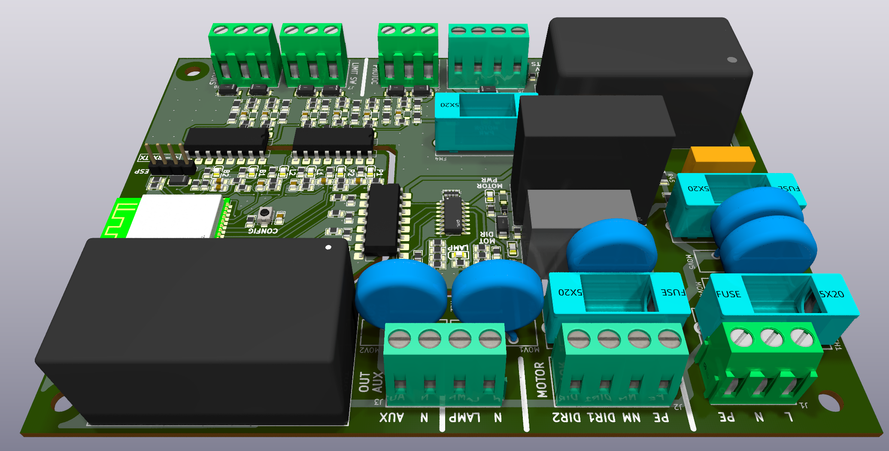
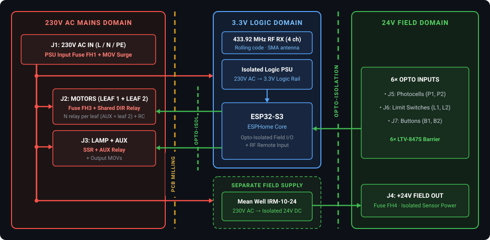

<h1 align="center">⛩️ ESPGate v1.0</h1>

<h2 align="center">⏳ Built to last 10 years. Isolated. Surge-protected. Local-first.</h2>

<b>Native ESPHome / Home Assistant 230V AC Gate &amp; Roller Shutter Controller</b>

   
  

> 💡 *Install it once. Forget it. Your gate just works—through thunderstorms, power surges and a decade of daily cycles.*

* 🧠 **Platform:** Custom `150 × 110 mm` PCB built around an `ESP32-S3-WROOM-1` for native ESPHome integration.
* ⚙️ **Target Load:** Single-phase `230V AC` sliding/swing gates and garage roller shutters.
* 🛡️ **Design Goal:** Industrial-grade mains isolation and surge protection in a single self-contained board—zero external relay modules or floating power supplies.
---

## 🤔 Why Yet Another Gate Controller?

* ❌ **The DIY Problem:** Cobbling consumer DIN-rail Wi-Fi relays with external `24V` PSUs and shared grounds leads to ESP32 brownouts, welded relay contacts, or fried GPIOs after the first thunderstorm.
* 🔒 **The Commercial Problem:** Traditional gate boards handle high voltage well, but trap you in proprietary remotes or clunky cloud bridges.
* ✅ **The ESPGate Solution:** Full galvanic isolation, dedicated surge protection, and hardware-interlocked relays paired with local-first ESPHome firmware.

> ⚠️ **HIGH VOLTAGE SAFETY WARNING**
> * Operates directly on lethal **230V AC mains voltage**. Always disconnect power at the main breaker before wiring or servicing.
> * Open-hardware DIY project without commercial CE certification—intended for experienced makers or installation by qualified personnel inside an IP56/IP65 enclosure.

---

## 📌 Project Status

* 🧪 **Stage:** Design complete, **not ordered yet**. The first prototype batch (PCB + SMT assembly from JLCPCB, `5` boards) is ready in the cart and will be ordered as soon as the 3 spare boards find a home.
* 🤝 **Looking for 3 early adopters:** I keep `2` boards for myself and I'm looking for `3` people willing to refund the cost of the other three boards (about `55–60 €` per board). Spending ~`300 €` for just two boards makes no sense, so splitting the batch is what makes this prototype run viable.
* 🛡️ **Risk is mine:** I will personally perform the **first power-up** and bring-up of every board. If a board doesn't work, that's on me, not on you.
* 📬 **Interested?** Open an issue or get in touch.

---

## 🏗️ System Architecture

---

## ✨ Key Hardware Features

* 🧠 **MCU & Debug:** `ESP32-S3-WROOM-1` with `FLASH`, `RESET`, and `CONFIG` tactile buttons, onboard UART header (`TX`/`RX`), and `STATUS` LED.
* 🔋 **Isolated Power:** Dual isolated Mean Well `IRM` AC/DC modules separating the `24V` field domain from the `3.3V` logic domain.
* ⚙️ **230V AC Motor Drive (`MOTOR`):**
  * Hardware-interlocked `AgSnO2` power relays (`MOTOR PWR` + `MOTOR DIR`) for Open/Close control (`AP` / `CH` / `COM`).
  * RC snubber networks across relay contacts to suppress inductive motor arcing.
* 🚨 **230V AC Auxiliary Outputs (`LAMP` / `AUX`):**
  * Opto-isolated Solid-State Relays (`BC2223A` SSRs) for flashing beacon (`LAMPEGGIANTE`) and auxiliary load (`AUX` / courtesy light / electric lock).
* 🛡️ **Protection & Creepage:**
  * Dedicated `5×20 mm` replaceable fuses (`FH1`–`FH4`) on mains, motor, and auxiliary rails.
  * `14D471K` Metal Oxide Varistors (`MOV`) on AC mains input and output stages.
  * Physical PCB milling slots (`Edge.Cuts`) between `230V AC` and low-voltage sections.
* 🔌 **6× Opto-Isolated 24V Field Inputs (`LTV-847S`):**
  * Galvanically isolated inputs with onboard diagnostic LEDs (`P1`, `P2`, `L1`, `L2`, `B1`, `B2`):
    * **Photocells (`PHOTOC`):** `P1`, `P2`
    * **Limit Switches (`LIMIT SW`):** `L1` (Open), `L2` (Close)
    * **Push-Buttons (`BUTTONS`):** `B1` (Step-by-Step / Open), `B2` (Close / Pedestrian)
  * Dedicated `+24V` output terminals (`+24V INPUTS`) to power photocells and dry-contact switches.
* 📦 **Enclosure Fit:** Fits inside a standard **Gewiss GW44207** (`190 × 140 × 70 mm`) IP56 junction box via a 3D-printed adapter plate.

---

## 🔩 Terminal Block Overview

* 🔌 **J1 (`AC IN`):** `230V AC 50Hz` mains input (`L`, `N`, `PE`) protected by `FH1` + `MOV`.
* ⚙️ **J2 (`MOTOR`):** `230V AC` single-phase motor output (`COM`, `OPEN`, `CLOSE`, `PE`) with hardware interlock and snubbers.
* 🚨 **J3 (`LAMP / AUX`):** `230V AC` Solid-State Relay outputs for flashing beacon (`LAMP`) and auxiliary load (`AUX`).
* 🔋 **J4 (`+24V INPUTS`):** Isolated `24V DC` sensor supply (`-`, `-`, `+24`, `+24`).
* 👁️ **J5 (`PHOTOC`):** Opto-isolated photocell inputs (`C`, `1`, `2` → `P1`, `P2`).
* 🛑 **J6 (`LIMIT SW`):** Opto-isolated open/close limit switch inputs (`C`, `1`, `2` → `L1`, `L2`).
* 🔘 **J7 (`BUTTONS`):** Opto-isolated wall push-button inputs (`C`, `1`, `2` → `B1`, `B2`).

---

## 📍 ESP32-S3 Pinout Map

* 📤 **Outputs:**
  * `GPIO4` (`MOTOR_PWR`, Active `HIGH`): Main motor power relay.
  * `GPIO5` (`MOTOR_DIR`, Active `HIGH`): Direction relay (`LOW` = Open, `HIGH` = Close).
  * `GPIO6` (`OUT_LAMP`, Active `HIGH`): Flashing beacon SSR (`LAMP`).
  * `GPIO7` (`OUT_AUX`, Active `HIGH`): Auxiliary SSR (`AUX`).
  * `GPIO48` (`LED_STATUS`, Active `HIGH`): Onboard status LED.
* 📥 **Inputs:**
  * `GPIO15` (`IN_PHOTOC_1`, Active `LOW`): Photocell 1 (`P1`).
  * `GPIO16` (`IN_PHOTOC_2`, Active `LOW`): Photocell 2 (`P2`).
  * `GPIO17` (`IN_LIMIT_OPEN`, Active `LOW`): Open limit switch (`L1`).
  * `GPIO18` (`IN_LIMIT_CLOSE`, Active `LOW`): Close limit switch (`L2`).
  * `GPIO8` (`IN_BTN_1`, Active `LOW`): Push-button 1 (`B1`).
  * `GPIO9` (`IN_BTN_2`, Active `LOW`): Push-button 2 (`B2`).
  * `GPIO0` (`BTN_CONFIG`, Active `LOW`): Onboard `CONFIG` / Boot button.

---

## 🚀 Quick Start (ESPHome)

* **1. Flash:** Connect a `3.3V` USB-to-UART adapter to the `ESP` header (`+`, `-`, `RX`, `TX`), hold `FLASH`, and press `RESET`.
* **2. Configure:** Load the ESPHome YAML configuration, set `secrets.yaml` (Wi-Fi + API key), and tune `open_duration` / `close_duration`.
* **3. Bench Test:** Verify limit switches (`L1`, `L2`) and photocells (`P1`, `P2`) via onboard diagnostic LEDs before connecting `230V AC` motor leads.

---

## 📜 Disclaimer & License

* **License:** CERN Open Hardware Licence v2 - Permissive (`CERN-OHL-P`) / `MIT`.
* **Liability:** Provided as-is for educational and DIY purposes; the author assumes no liability for personal injury, property damage, or regulatory compliance.