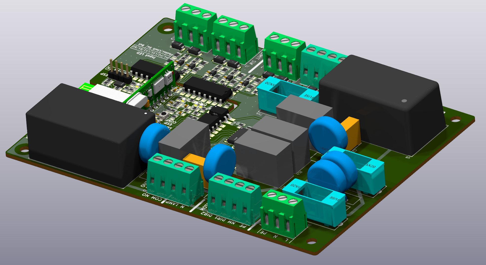
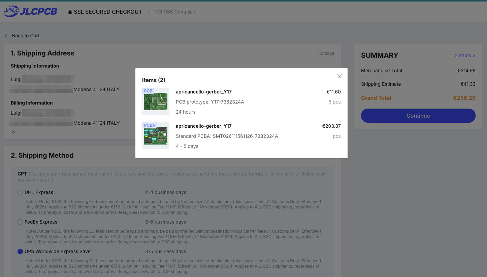
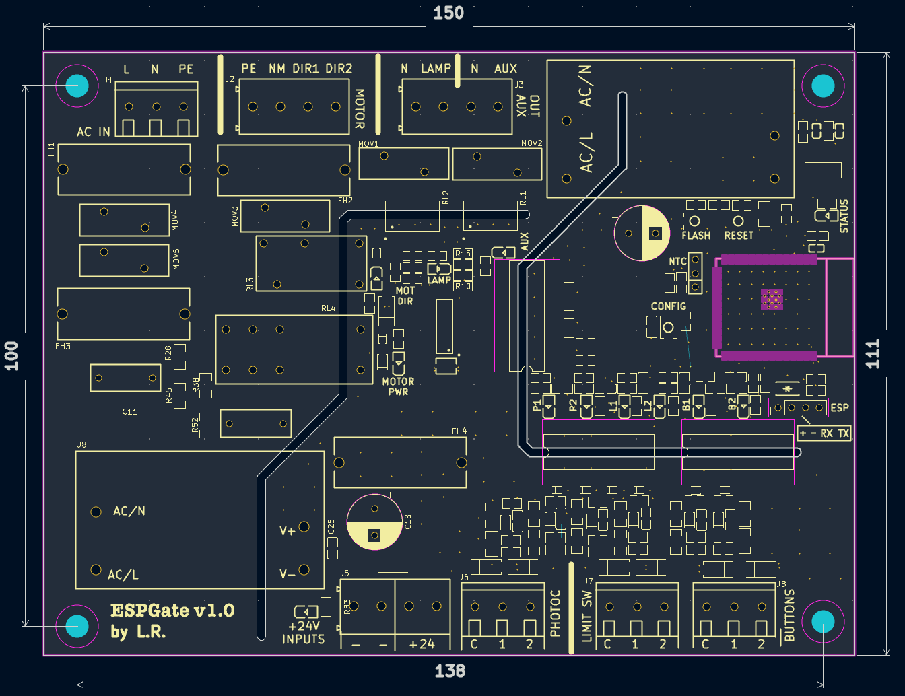

🇬🇧 English · <a href="README_IT.md">🇮🇹 Italiano</a>

<h1 align="center">⛩️ ESPGate v1.0</h1>

<h2 align="center">⏳ Built to last 10 years. Isolated. Surge-protected. Local-first.</h2>

<b>Native ESPHome / Home Assistant 230V AC Gate &amp; Roller Shutter Controller</b>

   
  

> 💡 *Install it once. Forget it. Your gate just works—through thunderstorms, power surges and a decade of daily cycles.*

* 🧠 **Platform:** Custom `150 × 110 mm` PCB built around an `ESP32-S3-WROOM-1` for native ESPHome integration.
* ⚙️ **Target Load:** Single-phase `230V AC` sliding/swing gates (**single or double leaf**) and garage roller shutters.
* 🛡️ **Design Goal:** Industrial-grade mains isolation and surge protection in a single self-contained board—zero external relay modules or floating power supplies.
* ⚙️ **Motors:** up to `2×` single-phase `230V AC` motors (open/close), one per leaf.
* 📥 **Inputs:** opto-isolated `24V` (photocells, limit switches, push-buttons) plus a `433.92 MHz` rolling-code RF receiver (`4` channels).
* 📤 **Outputs:** motor phase + direction relays, a neutral relay per leaf, `230V AC` flashing beacon (SSR) and a free-contact auxiliary relay (`AUX`).

---

## 🤔 Why Yet Another Gate Controller?

* ❌ **The DIY Problem:** Cobbling consumer DIN-rail Wi-Fi relays with external `24V` PSUs and shared grounds leads to ESP32 brownouts, welded relay contacts, or fried GPIOs after the first thunderstorm.
* 🔒 **The Commercial Problem:** Traditional gate boards handle high voltage well, but trap you in proprietary remotes or clunky cloud bridges.
* ✅ **The ESPGate Solution:** Full galvanic isolation, dedicated surge protection, and hardware-interlocked relays paired with local-first ESPHome firmware.

> ⚠️ **HIGH VOLTAGE SAFETY WARNING**
> * Operates directly on lethal **230V AC mains voltage**. Always disconnect power at the main breaker before wiring or servicing.
> * Open-hardware DIY project without commercial CE certification—intended for experienced makers or installation by qualified personnel inside an IP56/IP65 enclosure.

---

## 📌 Project Status

> ### 🙋 Looking for expenses split!
> Help me get the first `5` boards made: **3 spots available at ~`55–60 €` each.**

* 🧪 **Stage:** Design updated with **double-leaf support** and an **RF receiver** (see [Changelog](#-changelog)), **not ordered yet**. Some sections below (renders, terminals, architecture) may still describe the previous single-leaf revision.
* 📦 **Batch:** The first prototype batch (PCB + SMT assembly from JLCPCB, `5` boards) is ready in the cart and will be ordered as soon as the 3 spare boards find a home.
* 🤝 **Looking for 3 early adopters:** I keep `2` boards for myself and I'm looking for `3` people willing to refund the cost of the other three boards (about `55–60 €` per board). Spending ~`300 €` for just two boards makes no sense, so splitting the batch is what makes this prototype run viable.
* 🛡️ **Risk is mine:** I will personally perform the **first power-up** and bring-up of every board. If a board doesn't work, that's on me, not on you.
* 📬 **Interested?** Open an issue or get in touch.

---

## 📝 Changelog

### Unreleased (since v1.0)

* ➕ **Double-leaf gate support:**
  * The `AUX` `triac` output was replaced with a `relay`, and an extra `relay` + `optocoupler` were added to drive a second leaf.
  * Both leaves share the same `MOTOR DIR` relay, so they always move in the direction set by how the phase is wired: leaf 1 clockwise / leaf 2 counter-clockwise (standard), or leaf 1 clockwise / leaf 2 clockwise.
  * The delay between the two leaves is **programmable**.
  * The direction wires of the two motors are wired **in parallel** (phase), while each leaf has its **own neutral relay**: leaf 1 uses the dedicated neutral relay (`GPIO15`), leaf 2 uses the `AUX` relay (`GPIO5`) with `AUX COM` wired to `N`.
* 📡 **RF remote receiver:**
  * Added a [`433.92 MHz` 4-channel rolling-code receiver module](https://rf-modules.com/433-92-Receiver-Module-with-on-board-decoding-RC-RHCS-4CH-p244180431) with on-board decoding.
  * `SMA` connector on the PCB for an external antenna.
  * The `4` RF channels are wired to independent ESP32 GPIOs, not in parallel with the push-buttons.
* 📍 **Pinout:** updated to the current schematic.

---

## 🏗️ System Architecture

---

## ✨ Key Hardware Features

* 🧠 **MCU & Debug:** `ESP32-S3-WROOM-1` with `FLASH`, `RESET`, and `CONFIG` tactile buttons, onboard UART header (`TX`/`RX`), and `STATUS` LED.
* 🔋 **Isolated Power:** Dual isolated Mean Well `IRM` AC/DC modules separating the `24V` field domain from the `3.3V` logic domain.
* ⚙️ **230V AC Motor Drive (`MOTOR`):**
  * Hardware-interlocked `AgSnO2` power relays (`MOTOR PWR` + `MOTOR DIR`) for Open/Close control (`AP` / `CH` / `COM`).
  * RC snubber networks across relay contacts to suppress inductive motor arcing.
* 🚨 **230V AC Auxiliary Outputs (`LAMP` / `AUX`):**
  * Opto-isolated Solid-State Relay (`BC2223A` SSR) for the flashing beacon (`LAMPEGGIANTE`).
  * `AUX` relay output for an auxiliary load (courtesy light / electric lock) or, with `AUX COM` wired to `N`, as the neutral relay of leaf 2.
* 🛡️ **Protection & Creepage:**
  * Dedicated `5×20 mm` replaceable fuses: `FH1` on the power supplies input, `FH3` on the motors, `FH4` on the `+24V` supply of photocells and inputs.
  * `14D471K` Metal Oxide Varistors (`MOV`) on AC mains input and output stages.
  * Physical PCB milling slots (`Edge.Cuts`) between `230V AC` and low-voltage sections.
* 🔌 **6× Opto-Isolated 24V Field Inputs (`LTV-847S`):**
  * Galvanically isolated inputs with onboard diagnostic LEDs (`P1`, `P2`, `L1`, `L2`, `B1`, `B2`):
    * **Photocells (`PHOTOC`):** `P1`, `P2`
    * **Limit Switches (`LIMIT SW`):** `L1` (Open), `L2` (Close)
    * **Push-Buttons (`BUTTONS`):** `B1` (Step-by-Step / Open), `B2` (Close / Pedestrian)
  * Dedicated `+24V` output terminals (`+24V INPUTS`) to power photocells and dry-contact switches.
* 📦 **Enclosure Fit:** Fits inside a standard **Gewiss GW44207** (`190 × 140 × 70 mm`) IP56 junction box via a 3D-printed adapter plate.

---

## 🔩 Terminal Block Overview

* 🔌 **J1 (`AC IN`):** `230V AC 50Hz` mains input (`L`, `N`, `PE`) protected by `FH1` (power supplies input) + `MOV`.
* ⚙️ **J2 (`MOTOR`):** `230V AC` single-phase motor output (`COM`, `OPEN`, `CLOSE`, `PE`) with hardware interlock and snubbers.
* 🚨 **J3 (`LAMP / AUX`):** `230V AC` SSR output for the flashing beacon (`LAMP`) and `AUX` relay output (leaf 2 neutral when `AUX COM` is wired to `N`).
* 🔋 **J4 (`+24V INPUTS`):** Isolated `24V DC` sensor supply (`-`, `-`, `+24`, `+24`).
* 👁️ **J5 (`PHOTOC`):** Opto-isolated photocell inputs (`C`, `1`, `2` → `P1`, `P2`).
* 🛑 **J6 (`LIMIT SW`):** Opto-isolated open/close limit switch inputs (`C`, `1`, `2` → `L1`, `L2`).
* 🔘 **J7 (`BUTTONS`):** Opto-isolated wall push-button inputs (`C`, `1`, `2` → `B1`, `B2`).

---
## 📍 ESP32-S3 Pinout Map

* 📤 **Outputs:**
  * `GPIO16` (`ESP_REL_MOT_PWR`, Active `HIGH`): Motor phase activation relay (`MOTOR PWR`).
  * `GPIO7` (`ESP_REL_DIR`, Active `HIGH`): Direction relay (`MOTOR DIR`), shared by both leaves.
  * `GPIO15` (`ESP_N_MOT1`, Active `HIGH`): Neutral relay of motor 1 / leaf 1.
  * `GPIO6` (`ESP_LAMP`, Active `HIGH`): Flashing beacon SSR (`LAMP`).
  * `GPIO5` (`ESP_AUX`, Active `HIGH`): `AUX` relay, used as the neutral relay of leaf 2 when `AUX COM` is wired to `N`.
  * `GPIO4` (`ESP_LED_GR`, Active `HIGH`): Onboard green status LED (`STATUS`).
* 📥 **Inputs:**
  * `GPIO9` (`ESP_IN_FOTOC_1`, Active `LOW`): Photocell 1 (`P1`).
  * `GPIO10` (`ESP_IN_FOTOC_2`, Active `LOW`): Photocell 2 (`P2`).
  * `GPIO12` (`ESP_IN_LIMIT_1`, Active `LOW`): Limit switch 1 (`L1`).
  * `GPIO11` (`ESP_IN_LIMIT_2`, Active `LOW`): Limit switch 2 (`L2`).
  * `GPIO38` (`ESP_IN_BTN_1`, Active `LOW`): Push-button 1 (`B1`).
  * `GPIO39` (`ESP_IN_BTN_2`, Active `LOW`): Push-button 2 (`B2`).
  * `GPIO13` (`SW3`, Active `LOW`): Onboard `CONFIG` button.
* 📡 **RF Receiver (`J9`, `4` independent channels, not in parallel with the buttons):**
  * `GPIO14` (`RF_CH1`), `GPIO21` (`RF_CH2`), `GPIO40` (`RF_CH3`), `GPIO41` (`RF_CH4`), each with a `10 kΩ` pull-up to `3.3V`.
* 🔌 **Debug UART (`J4`):**
  * `GPIO0` (`SW1`, Active `LOW`): Onboard `FLASH` / Boot mode button.
  * `GPIO43` (`TXD0`) / `GPIO44` (`RXD0`): 3.3V UART header (`330 Ω` series protection resistors).

---

## 🚀 Quick Start (ESPHome)

* **1. Flash:** Connect a `3.3V` USB-to-UART adapter to the `ESP` header (`+`, `-`, `RX`, `TX`), hold `FLASH`, and press `RESET`.
* **2. Configure:** Load the ESPHome YAML configuration, set `secrets.yaml` (Wi-Fi + API key), and tune `open_duration` / `close_duration`.
* **3. Bench Test:** Verify limit switches (`L1`, `L2`) and photocells (`P1`, `P2`) via onboard diagnostic LEDs before connecting `230V AC` motor leads.

---

## 📜 Disclaimer & License

* **License:** CERN Open Hardware Licence v2 - Permissive (`CERN-OHL-P`) / `MIT`.
* **Liability:** Provided as-is for educational and DIY purposes; the author assumes no liability for personal injury, property damage, or regulatory compliance.

---

## 📐 Mechanical

* 🔩 **Mounting:** Secured by `4×` **M4** screws, one in each corner.
* 📏 **Board Size:** `150 × 111 mm`, mounting holes on a `138 × 100 mm` grid.

