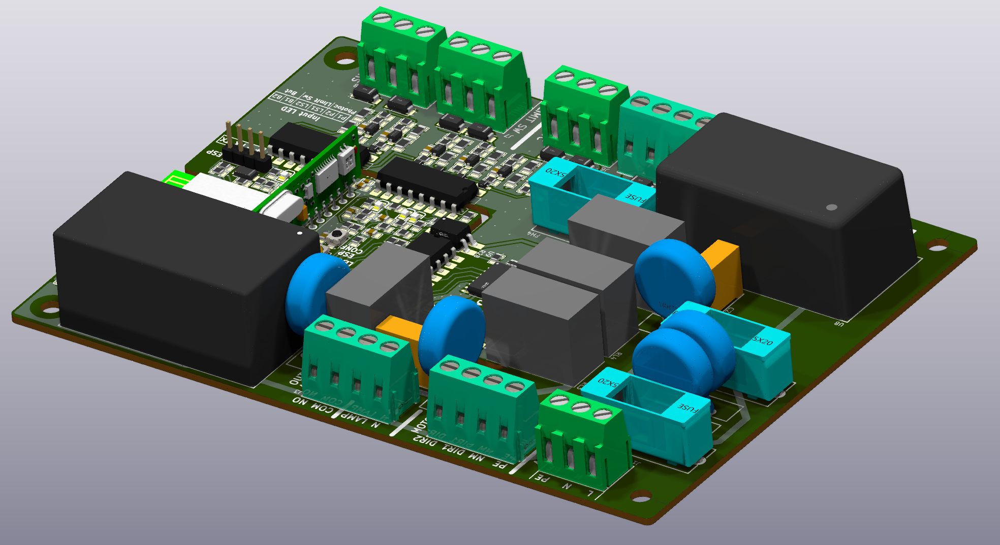
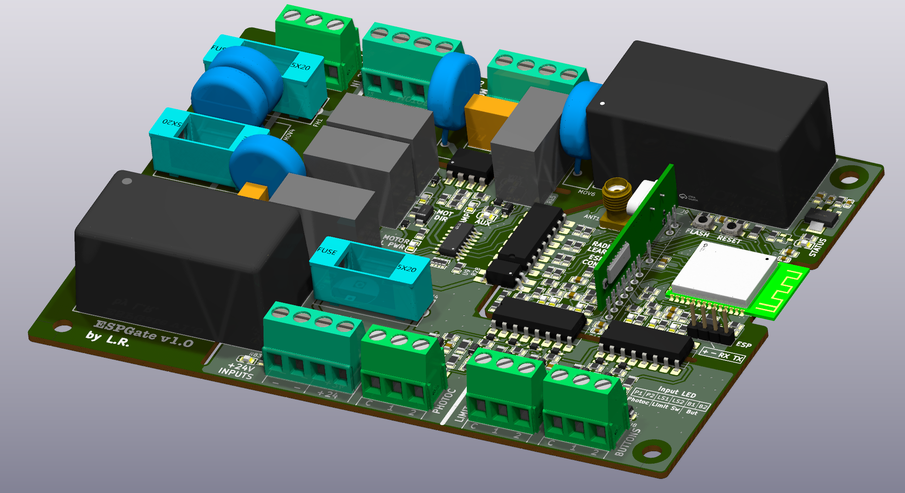
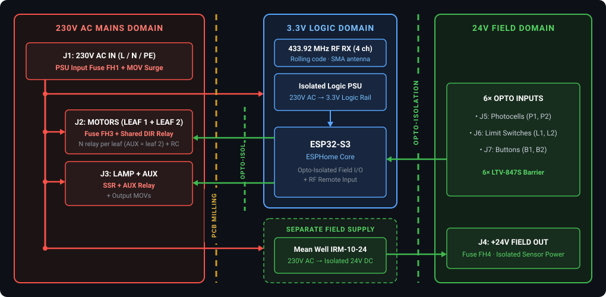
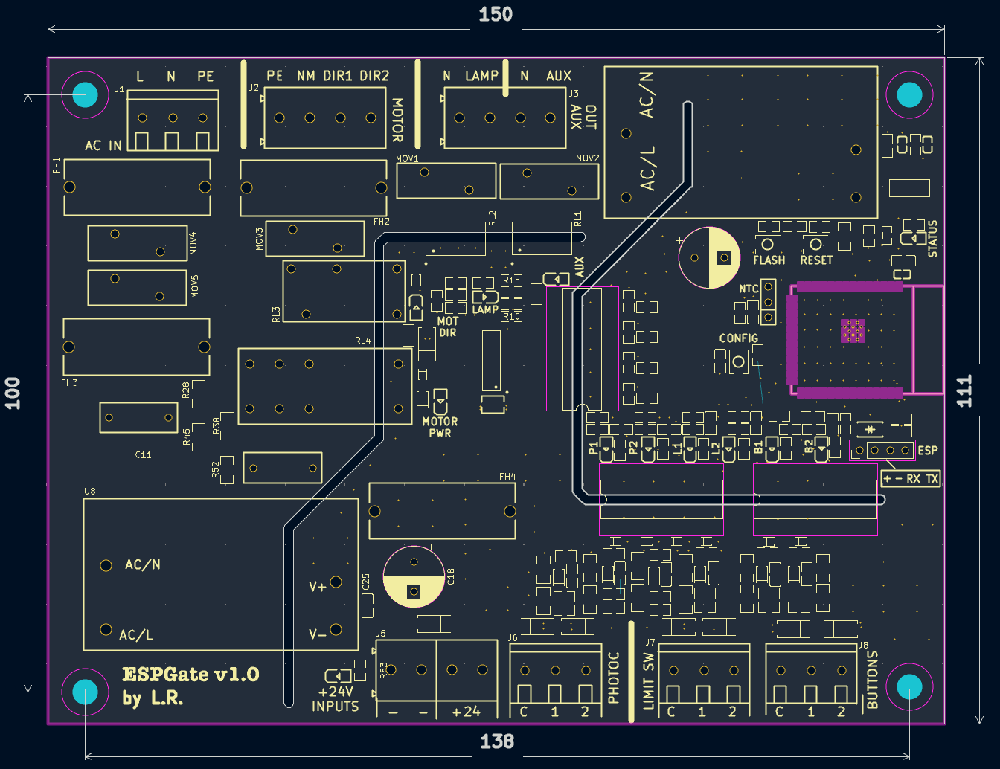

🇮🇹 Italiano · <a href="README.md">🇬🇧 English</a>

<h1 align="center">⛩️ ESPGate v1.0</h1>

<h2 align="center">⏳ Progettato per durare 10 anni. Isolato. Protetto dalle sovratensioni. Local-first.</h2>

<b>Controller nativo ESPHome / Home Assistant per cancelli e tapparelle a 230V AC</b>

   
  

> 💡 *Installalo una volta e dimenticatene. Il tuo cancello funziona e basta: tra temporali, sovratensioni e dieci anni di cicli quotidiani.*

* 🧠 **Piattaforma:** PCB custom `150 × 110 mm` basato su `ESP32-S3-WROOM-1` per l'integrazione nativa con ESPHome.
* ⚙️ **Carico:** cancelli scorrevoli/battenti monofase `230V AC` (**anta singola o doppia**) e tapparelle da garage.
* 🛡️ **Obiettivo di progetto:** isolamento dalla rete e protezione dalle sovratensioni di livello industriale in un'unica scheda autonoma, senza moduli relè esterni né alimentatori flottanti.
* ⚙️ **Motori:** fino a `2×` motori monofase `230V AC` (apre/chiude), uno per anta.
* 📥 **Ingressi:** `24V` optoisolati (fotocellule, finecorsa, pulsanti) più ricevitore RF `433.92 MHz` rolling code (`4` canali).
* 📤 **Uscite:** relè di fase e direzione motore, un relè di neutro per anta, lampeggiante `230V AC` (SSR) e relè ausiliario a contatto libero (`AUX`).

---

## 🤔 Perché l'ennesimo controller per cancelli?

* ❌ **Il problema del fai-da-te:** mettere insieme relè Wi-Fi da guida DIN, alimentatori `24V` esterni e masse in comune porta a reset dell'ESP32, contatti dei relè incollati o GPIO bruciati dopo il primo temporale.
* 🔒 **Il problema delle schede commerciali:** le schede per cancelli tradizionali gestiscono bene l'alta tensione, ma ti intrappolano in telecomandi proprietari o in scomodi servizi cloud.
* ✅ **La soluzione ESPGate:** isolamento galvanico completo, protezione dalle sovratensioni dedicata e relè con interblocco hardware, abbinati a un firmware ESPHome local-first.

> ⚠️ **AVVISO DI SICUREZZA - ALTA TENSIONE**
> * Funziona direttamente a **230V AC di rete**, una tensione letale. Prima di cablare o fare manutenzione, disconnetti sempre l'alimentazione dall'interruttore generale.
> * Progetto open hardware fai-da-te, privo di certificazione CE commerciale: pensato per maker esperti o per l'installazione da parte di personale qualificato, all'interno di un contenitore IP56/IP65.

---

## 📝 Changelog

### Non rilasciato (rispetto alla v1.0)

* ➕ **Supporto cancello a doppia anta:**
  * L'uscita `AUX` a `triac` è stata sostituita da un `relè`, ed è stato aggiunto un ulteriore `relè` + `fotoaccoppiatore` per pilotare la seconda anta.
  * Le due ante condividono lo stesso relè `MOTOR DIR`, quindi vanno sempre nel verso stabilito da come è collegata la fase: anta 1 oraria / anta 2 antioraria (standard), oppure anta 1 oraria / anta 2 oraria.
  * Il ritardo tra le due ante è **programmabile**.
  * I cavi di direzione dei due motori sono collegati **in parallelo** (fase), mentre ogni anta ha il **proprio relè di neutro**: l'anta 1 usa il relè di neutro dedicato (`GPIO15`), l'anta 2 usa il relè `AUX` (`GPIO5`) con `AUX COM` collegato a `N`.
* 📡 **Ricevitore telecomando RF:**
  * Aggiunto un [modulo ricevitore `433.92 MHz` a 4 canali rolling code](https://rf-modules.com/433-92-Receiver-Module-with-on-board-decoding-RC-RHCS-4CH-p244180431) con decodifica a bordo.
  * Connettore `SMA` sul PCB per l'antenna esterna.
  * I `4` canali RF sono collegati a GPIO dell'ESP32 indipendenti, non in parallelo ai pulsanti.
* 📍 **Pinout:** aggiornato allo schema elettrico attuale.

---

## 🏗️ Architettura del sistema

---

## ✨ Caratteristiche hardware principali

* 🧠 **MCU e debug:** `ESP32-S3-WROOM-1` con pulsanti `FLASH`, `RESET` e `CONFIG`, header UART a bordo (`TX`/`RX`) e LED `STATUS`.
* 🔋 **Alimentazione isolata:** due moduli AC/DC Mean Well `IRM` isolati che separano il dominio campo `24V` dal dominio logico `3.3V`.
* ⚙️ **Pilotaggio motore 230V AC (`MOTOR`):**
  * Relè di potenza `AgSnO2` con interblocco hardware (`MOTOR PWR` + `MOTOR DIR`) per il comando Apre/Chiude (`AP` / `CH` / `COM`).
  * Reti snubber RC sui contatti dei relè per sopprimere gli archi induttivi del motore.
* 🚨 **Uscite ausiliarie 230V AC (`LAMP` / `AUX`):**
  * Relè a stato solido optoisolato (SSR `BC2223A`) per il lampeggiante (`LAMPEGGIANTE`).
  * Uscita relè `AUX` per un carico ausiliario (luce di cortesia / elettroserratura) oppure, con `AUX COM` collegato a `N`, come relè di neutro dell'anta 2.
* 🛡️ **Protezioni e distanze di isolamento:**
  * Fusibili sostituibili dedicati `5×20 mm`: `FH1` all'ingresso degli alimentatori, `FH3` sui motori, `FH4` sulla alimentazione `+24V` di fotocellule e ingressi.
  * Varistori a ossido metallico `14D471K` (`MOV`) sull'ingresso di rete e sugli stadi di uscita AC.
  * Fresature fisiche del PCB (`Edge.Cuts`) tra le sezioni `230V AC` e a bassa tensione.
* 🔌 **6× ingressi di campo 24V optoisolati (`LTV-847S`):**
  * Ingressi isolati galvanicamente con LED diagnostici a bordo (`P1`, `P2`, `L1`, `L2`, `B1`, `B2`):
    * **Fotocellule (`PHOTOC`):** `P1`, `P2`
    * **Finecorsa (`LIMIT SW`):** `L1` (Apre), `L2` (Chiude)
    * **Pulsanti (`BUTTONS`):** `B1` (Passo-passo / Apre), `B2` (Chiude / Pedonale)
  * Morsetti di uscita `+24V` dedicati (`+24V INPUTS`) per alimentare fotocellule e contatti puliti.
* 📦 **Contenitore:** entra in una scatola di derivazione standard **Gewiss GW44207** (`190 × 140 × 70 mm`) IP56 tramite una piastra adattatrice stampata in 3D.

---

## 🔩 Panoramica dei morsetti

* 🔌 **J1 (`AC IN`):** ingresso di rete `230V AC 50Hz` (`L`, `N`, `PE`) protetto da `FH1` (ingresso alimentatori) + `MOV`.
* ⚙️ **J2 (`MOTOR`):** uscita motore monofase `230V AC` (`COM`, `OPEN`, `CLOSE`, `PE`) con interblocco hardware e snubber.
* 🚨 **J3 (`LAMP / AUX`):** uscita SSR `230V AC` per il lampeggiante (`LAMP`) e uscita relè `AUX` (neutro dell'anta 2 se `AUX COM` è collegato a `N`).
* 🔋 **J4 (`+24V INPUTS`):** alimentazione sensori `24V DC` isolata (`-`, `-`, `+24`, `+24`).
* 👁️ **J5 (`PHOTOC`):** ingressi fotocellule optoisolati (`C`, `1`, `2` → `P1`, `P2`).
* 🛑 **J6 (`LIMIT SW`):** ingressi finecorsa apre/chiude optoisolati (`C`, `1`, `2` → `L1`, `L2`).
* 🔘 **J7 (`BUTTONS`):** ingressi pulsanti a parete optoisolati (`C`, `1`, `2` → `B1`, `B2`).

---

## 📍 Mappa pin ESP32-S3

* 📤 **Uscite:**
  * `GPIO16` (`ESP_REL_MOT_PWR`, attivo `HIGH`): relè di attivazione fase motore (`MOTOR PWR`).
  * `GPIO7` (`ESP_REL_DIR`, attivo `HIGH`): relè di direzione (`MOTOR DIR`), condiviso dalle due ante.
  * `GPIO15` (`ESP_N_MOT1`, attivo `HIGH`): relè di neutro del motore 1 / anta 1.
  * `GPIO6` (`ESP_LAMP`, attivo `HIGH`): SSR del lampeggiante (`LAMP`).
  * `GPIO5` (`ESP_AUX`, attivo `HIGH`): relè `AUX`, usato come relè di neutro dell'anta 2 quando `AUX COM` è collegato a `N`.
  * `GPIO4` (`ESP_LED_GR`, attivo `HIGH`): LED verde di stato a bordo (`STATUS`).
* 📥 **Ingressi:**
  * `GPIO9` (`ESP_IN_FOTOC_1`, attivo `LOW`): fotocellula 1 (`P1`).
  * `GPIO10` (`ESP_IN_FOTOC_2`, attivo `LOW`): fotocellula 2 (`P2`).
  * `GPIO12` (`ESP_IN_LIMIT_1`, attivo `LOW`): finecorsa 1 (`L1`).
  * `GPIO11` (`ESP_IN_LIMIT_2`, attivo `LOW`): finecorsa 2 (`L2`).
  * `GPIO38` (`ESP_IN_BTN_1`, attivo `LOW`): pulsante 1 (`B1`).
  * `GPIO39` (`ESP_IN_BTN_2`, attivo `LOW`): pulsante 2 (`B2`).
  * `GPIO13` (`SW3`, attivo `LOW`): pulsante `CONFIG` a bordo.
* 📡 **Ricevitore RF (`J9`, `4` canali indipendenti, non in parallelo ai pulsanti):**
  * `GPIO14` (`RF_CH1`), `GPIO21` (`RF_CH2`), `GPIO40` (`RF_CH3`), `GPIO41` (`RF_CH4`), ciascuno con pull-up da `10 kΩ` a `3.3V`.
* 🔌 **UART di debug (`J4`):**
  * `GPIO0` (`SW1`, attivo `LOW`): pulsante `FLASH` / modalità boot a bordo.
  * `GPIO43` (`TXD0`) / `GPIO44` (`RXD0`): header UART a 3.3V (resistenze serie di protezione da `330 Ω`).

---

## 🚀 Avvio rapido (ESPHome)

* **1. Flash:** collega un adattatore USB-UART a `3.3V` all'header `ESP` (`+`, `-`, `RX`, `TX`), tieni premuto `FLASH` e premi `RESET`.
* **2. Configura:** carica la configurazione YAML di ESPHome, imposta `secrets.yaml` (Wi-Fi + chiave API) e regola `open_duration` / `close_duration`.
* **3. Test a banco:** verifica finecorsa (`L1`, `L2`) e fotocellule (`P1`, `P2`) tramite i LED diagnostici a bordo prima di collegare i cavi del motore a `230V AC`.

---

## 📜 Disclaimer e licenza

* **Licenza:** CERN Open Hardware Licence v2 - Permissive (`CERN-OHL-P`) / `MIT`.
* **Responsabilità:** fornito così com'è, per scopi didattici e fai-da-te; l'autore non si assume alcuna responsabilità per lesioni personali, danni a cose o conformità normativa.

---

## 📐 Meccanica

* 🔩 **Fissaggio:** si fissa con `4×` viti **M4**, una per ogni angolo.
* 📏 **Dimensioni scheda:** `150 × 111 mm`, fori di fissaggio su una griglia di `138 × 100 mm`.

